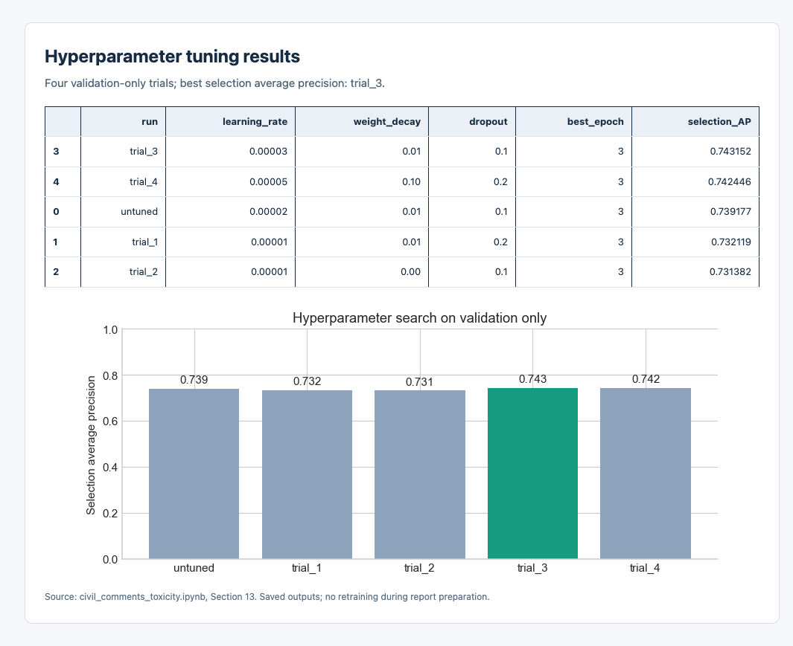
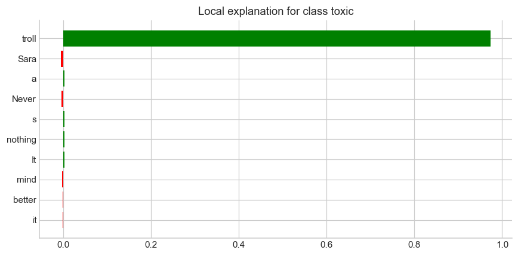

# Civil Comments Toxicity Classification — Technical Report

**Name:** Sakib Rayhan Yeasin  
**Student ID / Trainee ID:** 1000128462  
**Final notebook:** [civil_comments_toxicity.ipynb](civil_comments_toxicity.ipynb)

Results and figures come from the notebook's saved run; no retraining was performed.

## 1. Task, data, and model choice

The task is to classify an English comment as **toxic** or **not toxic** using
`google/civil_comments`. The dataset label is toxic when its annotation score is
**at least 0.5**. Only comment text is used as input.

I used **`distilbert/distilbert-base-uncased`**, a smaller, six-layer model distilled
from BERT. It understands English context while keeping training cost manageable.
[Model card](https://huggingface.co/distilbert/distilbert-base-uncased).
The model uses masked mean pooling, dropout, and a two-class linear head.

Normalized duplicate texts were removed within and across the official splits.
Stratified sampling used seed **42**:

| Partition | Comments | Toxic comments | Purpose |
| --- | ---: | ---: | --- |
| Training | 20,000 | 1,599 | Update weights |
| Validation: model selection | 3,000 | 236 | Choose settings and epoch |
| Validation: threshold selection | 3,000 | 236 | Choose the prediction threshold |
| Held-out test | 10,000 | 798 | Final comparison |

Only **7.98%** of test comments are toxic. Always predicting not toxic gives
**92.02% accuracy** but **zero toxic F1**. Therefore, **average precision (AP)**
guides model selection. Training uses class-weighted cross-entropy.

## 2. Training and hyperparameter tuning

| Version | What was trained | Encoder learning rate | Head dropout | Weight decay |
| --- | --- | ---: | ---: | ---: |
| Frozen baseline | Classifier head only, up to 10 epochs | Frozen; head rate `1e-3` | 0.1 | 0.01 |
| Without hyperparameter tuning | Encoder and head, 3 epochs | `2e-5` | 0.1 | 0.01 |
| With hyperparameter tuning | Encoder and head; selected trial 3, epoch 3 | `3e-5` | 0.1 | 0.01 |

“Without tuning” here means fine-tuning with fixed settings, without a
hyperparameter search. Each end-to-end candidate restarts from the same frozen
baseline checkpoint. Common settings are AdamW, maximum length **256 tokens**,
batch size **16**, gradient accumulation **2**, and **10% warmup**. The head
learning rate is five times the encoder rate.

The seeded random search tested **four configurations** from learning rates
`1e-5/3e-5/5e-5`, weight decay `0/0.01/0.1`, and dropout `0.1/0.2`.
Trial 3 had the highest model-selection AP: **0.743152**, compared with
**0.739177** for the untuned model. Test predictions were not used for selection.

### Screenshot of tuning results

*Screenshot rendered from the actual saved table and chart in notebook Section 13.*

## 3. Results and justification

Each model's decision threshold was chosen to maximize toxic F1 on the separate
threshold-selection partition. This threshold differs from the fixed **0.5 dataset
label cutoff**. These are results on the same **10,000 held-out test comments**:

| Model | Prediction threshold | Accuracy | AP | Toxic precision | Toxic recall | Toxic F1 |
| --- | ---: | ---: | ---: | ---: | ---: | ---: |
| Frozen baseline | 0.691624 | 89.42% | 0.4336 | 0.3827 | 0.5313 | 0.4449 |
| Without hyperparameter tuning | 0.795823 | 94.59% | 0.7086 | 0.6777 | 0.6140 | **0.6443** |
| With hyperparameter tuning | 0.886669 | **94.75%** | **0.7088** | **0.7191** | 0.5614 | 0.6305 |

**Fine-tuning produced the main improvement.** Adapting the encoder to this task
raised test AP from **0.4336 to 0.7086** and toxic F1 from **0.4449 to 0.6443**.

**Tuning raised precision and lowered recall.** Test AP improved only slightly.
At the separately selected thresholds, false positives fell from **233 to 175**,
but false negatives increased from **308 to 350**. Precision and accuracy improved,
while recall and F1 decreased. At a common prediction threshold of **0.5**, toxic
F1 was **0.6424 without tuning** and **0.6451 with tuning**, showing that the
operating threshold contributes to the difference. The untuned model retained
better test F1 and recall at their selected thresholds.

The selected model's training AP reached **0.9845**, while selection AP was
**0.7432**. Validation loss also rose from **0.3189 to 0.6617** over three epochs.
This suggests overfitting or increasing overconfidence. Four trials and one seed
do not establish a reliable tuning advantage. See the saved [learning curves](reports/final/tuned_learning_curves.png)
and [confusion matrices](reports/final/confusion_matrices.png).

## 4. Tests on real-world text

Recorded tuned-model predictions, using threshold **0.886669**:

| Input | Predicted class | Toxic score | Short check |
| --- | --- | ---: | --- |
| “Thanks for the report!” | Not toxic | 0.000004 | Polite appreciation; the prediction is reasonable. |
| “why don't you fuck off and make it better” | Toxic | 0.996441 | A hostile command containing profanity; the prediction is reasonable for this excerpt. |

Sources: [CPython issue reply](https://github.com/python/cpython/issues/160299)
and [The Register forum reply](https://forums.theregister.com/forum/all/2015/10/06/linix_kernel_dev_who_asked_linus_torvalds_to_stop_swearing_quits_over_swearing/).
The second input is an excerpt, so context matters. All six sourced excerpts
matched their expected labels, but this small, subjective check does not establish
deployment accuracy. Scores are not calibrated probabilities.

## 5. Explainability method and prediction analysis

I used **LIME** because it gives readable, word-level explanations of individual
predictions through a model-independent local approximation.
[LIME paper](https://arxiv.org/abs/1602.04938).
The notebook masks word occurrences with `[MASK]`, uses **512 perturbations**,
reports **10 features**, and repeats each explanation with seeds **42 and 179**.
Positive weights increase the local toxic score; negative weights decrease it.

The examples below use full comments from notebook Section 21; shortened inputs
are marked as excerpts.

| Case and input | Recorded prediction | What LIME shows | Local fit / stability |
| --- | --- | --- | --- |
| Real-world hostile command above | Toxic, score 0.996441 | `fuck` has weight **+0.9758**, dominating this local decision. | R² **0.9995**; feature-set overlap **1.0000** |
| Test false positive: “Never mind hodad, Sara, it's just a troll. It has nothing better to do.” | Toxic, score ≈1.0; dataset label is not toxic | `troll` has weight **+0.9736**. This suggests strong reliance on one lexical cue. A faithful explanation can still describe an incorrect prediction. | R² **0.9994**; overlap **0.6667** |
| Test false negative, excerpt: “It must be nice to have no shame…” | Not toxic, score **0.000014**; dataset label is toxic | `waste` is slightly positive (**+0.0026**) and `thinking` negative (**−0.0020**), but the weak local fit prevents a confident explanation of the missed contextual criticism. | R² **0.1847**; overlap **0.3333** |

Overlap is Jaccard similarity of the two feature sets, a limited stability check.
The false positive is defined relative to the dataset label; human judgments may
differ. LIME describes local behavior, not causality or intent.

Additional saved plots: [correct toxic prediction](reports/final/lime_real_03.png)
and [false negative](reports/final/lime_false_negative.png).

## 6. Limitations and reproduction

The authored stress tests exposed further errors: “I am gay and proud of my
community.” and “Please do not call other people idiots.” were flagged as toxic.
These examples show context and fairness risks; they are not a population-level
fairness assessment. More seeds, broader evaluation, and stronger context handling
are needed before deployment.

Figures and metrics above were extracted from the notebook's saved CUDA run.
The configuration cell currently has no saved execution count, so a fresh
**Run All** is needed to verify reproducibility of the current notebook state.
Use the existing environment, set `ROOT` to this assignment folder, and choose
`DATA_SOURCE = "local"` to reuse the included Parquet files. No notebook code or
outputs were changed while writing this report.

Earlier setup and module documentation is preserved in
[implementation reference](reports/implementation_reference.md); its execution-status
notes describe the earlier development stage, not the final saved notebook results.
