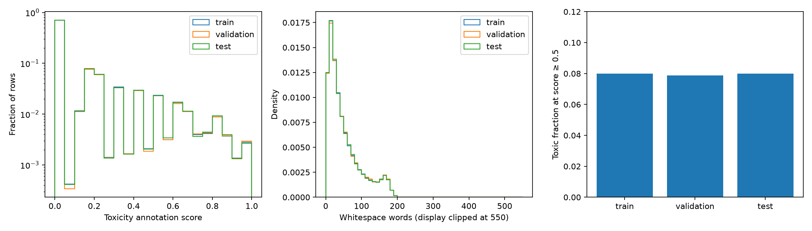

# Civil Comments: observed split audit

Label: **toxic if toxicity ≥ 0.5**.

Source for this audit: `local`. All rows were scanned; no model was loaded.

| Official split | Rows | Toxic | Toxic % | Median words | 95th percentile words | Normalized duplicate rows |
|---|---:|---:|---:|---:|---:|---:|
| train | 1,804,874 | 144,334 | 7.997 | 35 | 159 | 28,366 |
| validation | 97,320 | 7,671 | 7.882 | 35 | 159 | 565 |
| test | 97,320 | 7,777 | 7.991 | 35 | 159 | 573 |

## Integrity and ambiguity

- train: 0 invalid/empty rows; 37,896 scores exactly 0.5; 129,241 scores in [0.4, 0.6]; 809 normalized text groups with conflicting labels.
- validation: 0 invalid/empty rows; 2,022 scores exactly 0.5; 6,831 scores in [0.4, 0.6]; 26 normalized text groups with conflicting labels.
- test: 0 invalid/empty rows; 1,989 scores exactly 0.5; 6,898 scores in [0.4, 0.6]; 21 normalized text groups with conflicting labels.
- train__validation: 1,320 shared normalized texts.
- train__test: 1,363 shared normalized texts.
- validation__test: 686 shared normalized texts.

Rows after invalid-row removal and deduplication (test > validation > train): `{'train': 1774208, 'validation': 96069, 'test': 96747}`.

See `dataset_audit.json` for score ranges, missingness, threshold sensitivity, and full length quantiles.
Whitespace counts are not WordPiece token counts. Sequence-length coverage must be measured with the model tokenizer.
This audit examines test integrity and aggregate distributions only. Model choices and threshold selection use validation, never test outcomes.
